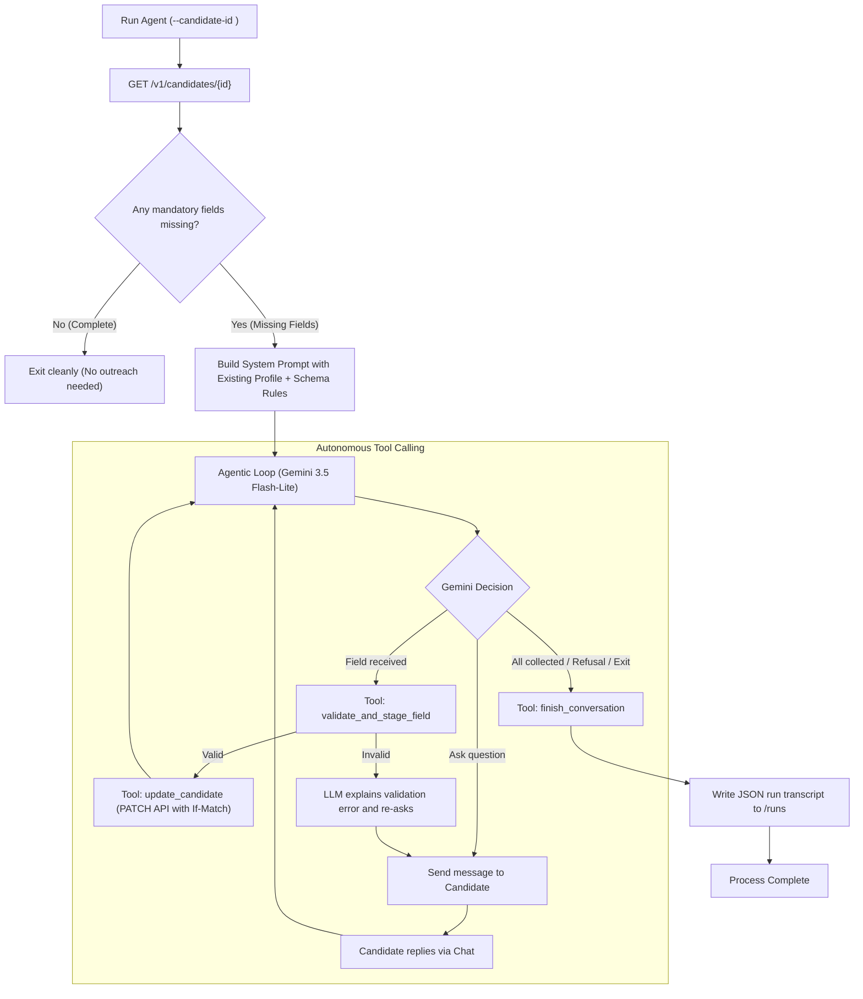

# AI Agent for Candidate Information Collection

**Assignment NMIMS'26** ·

An autonomous AI chat agent that completes internship applications by conversing naturally
with candidates over a terminal chat interface (simulating WhatsApp).

---

## Setup & Run

```bash
# 1. Clone the repo
git clone https://github.com/utkarshqz/prodigal-assignment-
cd prodigal-assignment-

# 2. Install dependencies
pip install -r requirements.txt

# 3. Configure environment
cp .env.example .env
# Edit .env — set GEMINI_API_KEY (free at https://aistudio.google.com/apikey)
# CANDIDATE_API_KEY is already set for the workspace

# 4. Run the Agent & Dashboards

### Option A: Web Applications (Recommended for Demonstration)
```bash
python app.py
```
Open in your browser:
- 🧑‍🎓 **Student Chat Portal**: `http://127.0.0.1:5000/`  
  Clean candidate chat interface to test completing an application.
- 🛡️ **Administrator DB & Transcript Monitor**: `http://127.0.0.1:5000/admin`  
  Live view of all candidate records in the DB, statuses, missing fields, and chat transcripts.
- ⚡ **Agent Actions & Tool Calls Inspector**: `http://127.0.0.1:5000/agent-telemetry`  
  Real-time telemetry stream showing LLM tool calls (`validate_and_stage_field`, `update_candidate`, `finish_conversation`) and API request payloads.

### Option B: Terminal CLI Chat Loop
```bash
python agent.py --candidate-id c001
```

### Option C: Reset Workspace Data
```bash
python -c "import api_client; api_client.reset_workspace(); print('Reset done')"
```

**To exit a chat:** type `/quit` or `/done`.  
**Run logs** are saved automatically to `runs/<candidate_id>_<timestamp>.json`.

---

## Architecture



```text
+-------------------------------------------------------------------------------+
|                             AGENT EXECUTION FLOW                              |
+-------------------------------------------------------------------------------+
  run: python agent.py --candidate-id <id>
        |
        +--> 1. GET /v1/candidates/{id} (Fetch record & compute missing fields)
        |       If nothing missing --> Exit immediately (Zero wasted contacts)
        |
        +--> 2. Build Gemini System Prompt (Candidate profile + schema rules)
        |
        +--> 3. Agentic Loop (Gemini 3.5 Flash-Lite + Function Calling)
        |       +-------------------------------------------------------------+
        |       | LLM evaluates candidate input and decides next action:      |
        |       |   * validate_and_stage_field -> Enforces local validation   |
        |       |   * update_candidate         -> PATCH API with If-Match     |
        |       |   * finish_conversation      -> Records final status        |
        |       |   * get_candidate_info       -> Re-fetches current DB state |
        |       |                                                             |
        |       | Tool response fed back into LLM -> Natural reply generated  |
        |       +-------------------------------------------------------------+
        |
        +--> 4. Final outcome saved to DB & Run transcript written to runs/<id>.json
+-------------------------------------------------------------------------------+
```

### Tools the LLM can call

| Tool | Purpose |
|------|---------|
| `get_candidate_info` | Re-fetch candidate from API; get updated missing-field list |
| `validate_and_stage_field` | Validate one field value against schema rules (local); stage it |
| `update_candidate` | PATCH validated fields to API; set status + notes |
| `finish_conversation` | Record final outcome and exit |

### State

- **`AgentState`** (in-process): staged validated values, chat log, tool call log
- **Candidate record** (remote): authoritative source; read via GET, written via PATCH
- **Run logs** (`runs/`): JSON files with full chat + tool call history

---

## Edge Case Decisions

| Situation | Behaviour |
|-----------|-----------|
| **Nothing missing** | Agent exits immediately without starting a chat |
| **Candidate says "continue later"** | `finish_conversation(in_progress)`, notes record what's left |
| **Candidate stops replying / types `/quit`** | Save collected data, `finish_conversation(in_progress)` or `no_answer` depending on what was gathered |
| **Invalid answer (e.g. CGPA 85)** | `validate_and_stage_field` catches it; agent explains and re-asks |
| **Ambiguous answer** | LLM asks a follow-up to clarify before validating |
| **Refused field** | Noted in `notes`; agent continues collecting other fields; final status `refused` |
| **Disputed / contradictory existing data** | Agent flags it, sets `needs_human` with explanation in notes |
| **API 409 conflict** | Re-read record and retry PATCH once automatically |
| **API 422 / unknown error** | Logged; agent continues conversation; noted in final status |
| **Existing data looks wrong** | Agent gently confirms (e.g. CGPA 9.1 ✓, graduation_year 2020 ✗ → asks to verify) |

---

## Status

### ✅ Works
- Fetches candidate and identifies missing fields
- Natural multi-turn conversation via Gemini 1.5 Flash function calling
- Validates all field types: email, CGPA, degree enum, graduation year, date, location, duration
- Writes updates mid-conversation and on completion
- Handles `/quit` / `/done` exit with status saved
- Optimistic concurrency (If-Match + retry on 409)
- Idempotency keys on every PATCH
- Run logs saved to `runs/`
- Skips candidates with complete records

### ⚠️ Known Limitations
- No real WhatsApp/SMS integration (terminal only, by design per assignment)
- Gemini free tier has rate limits (15 req/min on flash); heavy testing may hit limits
- Multi-language support not implemented

### 🔭 What I'd Build Next
1. **Queue runner**: process all pending candidates sequentially (`agent.py --all`)
2. **Retry scheduler**: re-contact `in_progress` / `no_answer` candidates after a delay
3. **Web UI**: simple Flask/FastAPI chat page instead of terminal
4. **Webhook integration**: real WhatsApp Business API via Twilio
5. **Better ambiguity handling**: slot-filling with clarification graph
6. **Confidence scoring**: flag low-confidence extractions for human review

---

## Candidates Summary

| ID | Name | Missing Fields |
|----|------|---------------|
| c001 | Aarav Mehta | email, cgpa |
| c002 | Priya Nair | graduation_year, available_from, internship_duration_months |
| c003 | Rohan Kulkarni | *(complete)* |
| c004 | Sneha Iyer | college, degree, branch |
| c005 | Kabir Shah | preferred_location |
| c006 | Ananya Desai | *(complete)* |
| c007 | Vikram Rao | *(all mandatory fields missing)* |
| c008 | Meera Joshi | cgpa |

